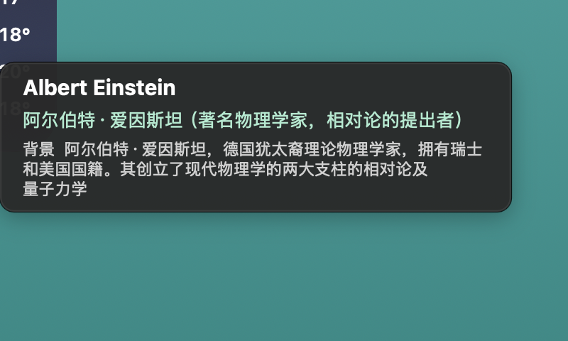

# HoverTranslator

**鼠标停在英文单词上，自动朗读 + 显示中文；人名地名还会补一句背景解释。**

一个 macOS 菜单栏小工具：不用选中、不用复制、不用切窗口，光标停一下就能查词。


---

## 这是什么

看英文 PDF、论文、网页、说明书时，遇到不认识的词，通常要：选中 → 复制 → 打开翻译网站 → 粘贴 → 看结果 → 切回来。
这个工具把这一串操作压成**一个动作**：鼠标在单词上停 0.45 秒。

它会：

- 截取光标周围一小块屏幕，用系统 OCR 认出**光标正下方那个词**（不是整行）
- 用美式发音读出来
- 弹出一个小窗显示：音标 + 中文释义
- 如果是人名、地名、机构（如 `Kyoto`、`Albert Einstein`、`Baker Street`），再多给一行**背景解释**：它在哪个国家、是什么身份、为什么重要

## 截图

| 普通单词 | 人名/地名背景 |
|---|---|
|  |  |

## 适合谁

- 经常读英文 PDF / 论文 / 技术文档，但不想来回切换翻译网站
- 看英文材料时遇到人名、地名、机构名，想顺手知道"这是谁/这是哪"
- 想要一个不抢焦点、不挡操作、不依赖代理的小工具

## 30 秒上手

1. 从 [**Releases**](https://github.com/ZXicoding/HoverTranslator/releases/latest) 下载 `HoverTranslator-macOS.zip`，解压
2. 把 `HoverTranslator.app` 拖进「应用程序」，**右键点图标 → 打开**（第一次必须这样，之后双击即可）
3. 按提示到 系统设置 → 隐私与安全性 → **屏幕与系统录音** 授权，然后退出重开应用

菜单栏出现 `译 ●` 就说明在运行了。鼠标停在任意英文单词上 0.45 秒试试。

## 功能一览

- **悬停即译**：OCR 逐词定位，取的是光标下的词，不是整行
- **美音朗读**：系统 `en-US` 语音，可调语速
- **音标 + 中文**：有道词典为主，MyMemory 机翻兜底
- **专名背景**：维基百科首句，说明国家 / 身份 / 历史；维基不可达时自动用有道网络释义
- **多词专名**：`New York`、`Albert Einstein` 会作为整体查询
- **任意场景**：PDF、Word、网页、图片扫描件、全屏应用都能用
- **不挡操作**：悬浮窗不抢焦点、不挡鼠标；光标移开约 1 秒自动收起，最长停留 3.6–6.5 秒
- **不依赖代理**：翻译直连优先，Clash 关闭或切节点也能用
- **可诊断**：菜单栏「网络诊断…」+ `~/Library/Logs/HoverTranslator.log`

## 系统要求

- macOS 14.0 (Sonoma) 或更新
- Apple 芯片 / Intel 芯片均可（通用二进制）

> 必须授予「屏幕与系统录音」权限，这是 ScreenCaptureKit 截图的前置条件。

## 从源码编译

```bash
# 生成并打开本机应用（增量编译，源码未改不会重建）
./build.sh && open HoverTranslator.app

# 生成固定命名的分发包（新版直接覆盖旧包）
./package.sh
```

自检命令（不需要屏幕录制权限也能跑一部分）：

```bash
./build.sh --selftest                  # OCR 取词（含 13pt Retina 小字）
./build.sh --test-translate Kyoto      # 翻译
./build.sh --context Kyoto              # 维基背景查询
./build.sh --test-tts hello            # 朗读
./build.sh --check-permission          # 屏幕录制权限状态
./build.sh --selftest-live 300 300     # 真实屏幕截图取词（需权限）
```

## 实现要点

| 模块 | 方案 |
|---|---|
| 截图 | ScreenCaptureKit `SCScreenshotManager`（macOS 15 起 `CGDisplayCreateImage` 已移除） |
| 取词 | Vision `VNRecognizeTextRequest` + `boundingBox(for:)` 逐词定位，选离光标最近的词 |
| 专名短语 | 同一行向左右扩展连续大写词（`New York`、`Albert Einstein`） |
| 朗读 | `AVSpeechSynthesizer`（`en-US`） |
| 翻译 | 有道 `jsonapi` / `suggest` → MyMemory → Google；直连优先 + 并行 + 重试 + 熔断 |
| 背景 | 中文维基百科 `generator=search` 首句，失败退回有道 `web_trans` |
| 界面 | AppKit 无边框 `NSPanel`，按内容自适应高度，手动折行避免固定窗口裁切 |

开发过程中踩过的坑都记录在 [docs/修复说明.md](docs/修复说明.md)，包括：

- 后台线程操作 AppKit 导致的 SIGTRAP / SIGABRT 崩溃
- 截图坐标系（CGEvent 是 y-down、SCK sourceRect 也是左上原点）与多显示器换算
- 定时器每 0.18s 重复触发导致的并发截图
- 有道自动纠错（`delulu → delugu 大洪水`）导致的错误释义
- OCR 截断长词（`transla → translate`）的补全
- TCC 授权与 ad-hoc 签名 cdhash 的关系

## 目录结构

```
main.swift          # 全部实现（单文件）
build.sh            # 编译 + 增量构建 + 本机签名
package.sh          # 打固定命名的分发包（自动覆盖旧包）
docs/               # 使用说明、修复说明、截图
AppIcon.icns        # 应用图标
```

## 已知限制

- 必须授予「屏幕与系统录音」权限
- 只识别英文单词，中文/数字/符号区域不触发
- 太新的生造词（如 `enshittification`）免费词典/机翻都没有中文结果，会明确提示「词典未收录该词」
- 背景解释依赖维基/有道是否有该词条；没有时只显示翻译和音标

## License

[MIT](LICENSE)
