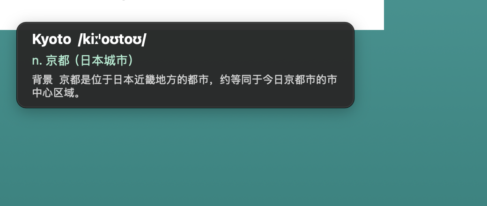

# HoverTranslator

鼠标停在英文单词上，自动朗读 + 显示中文释义；人名、地名等专有名词还会补一行背景解释（国家、身份、历史）。

A macOS menu-bar app: hover over an English word → it OCRs the word under the cursor, speaks it with a US voice, and shows the Chinese meaning plus a short background note for proper nouns (people, places, organizations).



## 功能

- **悬停即译**：鼠标停在任意英文单词上约 0.45 秒，自动识别光标下的那个词（不是整行）
- **美音朗读**：系统 `en-US` 语音（默认 Samantha），可调语速
- **音标 + 中文**：有道词典为主，MyMemory 机翻兜底，Google 作为境外可选源
- **专有名词背景**：`New York`、`Albert Einstein`、`Baker Street` 这类专名会额外显示一句"背景"
  - 首选中文维基百科词条首句；维基不可达时自动退回有道的网络释义摘要
  - 普通单词和菜单项不会触发，避免噪音
- **任意场景可用**：PDF、Word、网页、图片（扫描件）、全屏应用都能识别
- **无焦点打扰**：悬浮窗不抢焦点、不挡鼠标；光标移开约 1 秒自动收起，光标停留时最长 3.6–6.5 秒
- **不依赖代理**：翻译走直连优先，Clash 关闭/切节点也能正常翻译
- **可诊断**：菜单栏「网络诊断…」+ `~/Library/Logs/HoverTranslator.log`

## 系统要求

- macOS 14.0 (Sonoma) 或更新
- Apple 芯片 / Intel 芯片均可（通用二进制）

## 安装

1. 从 [Releases](../../releases) 下载 `HoverTranslator-macOS.zip` 并解压
2. 把 `HoverTranslator.app` 拖进「应用程序」
3. **第一次打开要右键点图标 → 打开**（没有苹果开发者签名，之后双击即可）
4. 按提示到 系统设置 → 隐私与安全性 → **屏幕与系统录音** 授权，然后退出重开应用

详细步骤见 [docs/使用说明.txt](docs/使用说明.txt)。

## 从源码编译

```bash
# 生成并打开本机应用（增量编译，源码未改不会重建）
./build.sh && open HoverTranslator.app

# 生成固定命名的分发包（覆盖旧包）
./package.sh
```

自检命令：

```bash
./build.sh --selftest            # OCR 取词（含 13pt Retina 小字）
./build.sh --test-translate Kyoto
./build.sh --context Kyoto       # 维基背景查询
./build.sh --test-tts hello
./build.sh --check-permission
./build.sh --selftest-live 300 300   # 真实屏幕截图取词（需屏幕录制权限）
```

## 实现要点

| 模块 | 方案 |
|---|---|
| 截图 | ScreenCaptureKit `SCScreenshotManager`（macOS 15 起 `CGDisplayCreateImage` 已移除） |
| 取词 | Vision `VNRecognizeTextRequest` + `boundingBox(for:)` 逐词定位，选光标最近的词 |
| 专名短语 | 从同一行向左右扩展连续大写词（`New York`、`Albert Einstein`） |
| 朗读 | `AVSpeechSynthesizer`（`en-US`） |
| 翻译 | 有道 `jsonapi` / `suggest` → MyMemory → Google，直连优先 + 并行 + 重试 + 熔断 |
| 背景 | 中文维基百科 `generator=search` 首句，失败退回有道 `web_trans` |
| 界面 | AppKit 无边框 `NSPanel`，按内容自适应高度，手动折行避免固定窗口裁切 |

更完整的踩坑记录与修复说明见 [docs/修复说明.md](docs/修复说明.md)，包括：

- 后台线程操作 AppKit 导致的 SIGTRAP / SIGABRT 崩溃
- 截图坐标系（CGEvent 是 y-down、SCK sourceRect 也是左上原点）与多显示器换算
- 定时器每 0.18s 重复触发导致的并发截图
- 有道自动纠错（`delulu → delugu 大洪水`）导致的错误释义
- OCR 截断长词（`transla → translate`）的补全
- TCC 授权与 ad-hoc 签名 cdhash 的关系

## 目录结构

```
main.swift          # 全部实现（单文件）
build.sh            # 编译 + 增量构建 + 本机签名
package.sh          # 打固定命名的分发包（自动覆盖旧包）
docs/               # 使用说明、修复说明、截图
AppIcon.icns        # 应用图标
```

## 已知限制

- 必须授予「屏幕与系统录音」权限（ScreenCaptureKit 的前置条件）
- 只识别英文单词，中文/数字/符号区域不触发
- 太新的生造词（如 `enshittification`）免费词典/机翻都没有中文结果，会明确提示「词典未收录该词」
- 背景解释依赖维基/有道是否有该词条；没有时只显示翻译和音标

## License

[MIT](LICENSE)
